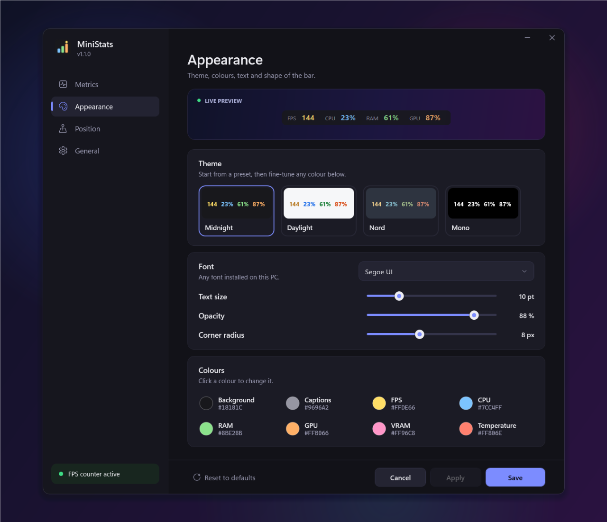
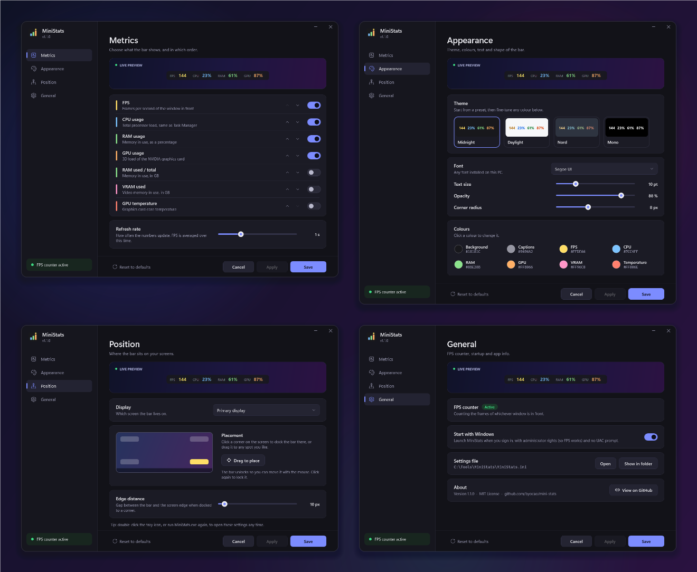

<div align="center">


# MiniStats

**A tiny, always-on-top FPS / CPU / RAM / GPU overlay for Windows.**
One small executable. No installer, no runtime to download, no background services.

[](https://github.com/byocao/mini-stats/actions/workflows/build.yml)
[](https://github.com/byocao/mini-stats/releases/latest)

[](LICENSE)


</div>

---

## Why

Most hardware overlays are either tied to a GPU vendor's app, need a hotkey before they show up, or drag in a
kernel driver and 100+ MB of RAM just to print four numbers. MiniStats does one thing: it keeps a small,
click-through bar in the corner of your screen with the numbers you actually look at while gaming — and gets out
of the way.

## Features

- **Real FPS** of whatever window is in the foreground — games, emulators, browsers, video players.
  Measured from the same Windows present events that [PresentMon](https://github.com/GameTechDev/PresentMon) uses,
  so it works with DirectX 9/10/11/12 and falls back to kernel-level present events for other graphics APIs.
- **CPU** usage from the same counter as Task Manager (`% Processor Utility`).
- **RAM** usage as a percentage or as `used / total GB`.
- **GPU** load, **VRAM** and **GPU temperature** via NVIDIA NVML (ships with the driver — nothing to install).
- **Always on top & click-through**: it never steals focus or blocks a click. Stays visible over borderless/windowed games.
- **Settings window** with a live preview: metrics and their order, themes, colours, font, opacity, corners,
  display, corner or free placement, start with Windows. Every change shows on the real bar instantly.
- **Multi-monitor aware**: dock to any corner of any display, per-monitor DPI aware.
- **Featherweight**: around 0.5 % CPU on a typical gaming PC and ~15 MB of RAM in use, a single ~180 KB `.exe`
  built on the .NET Framework that already ships with Windows.

<p align="center"></p>
<p align="center"></p>

## Quick start

1. Download `MiniStats-win-x64.zip` from the [latest release](https://github.com/byocao/mini-stats/releases/latest)
   and extract it anywhere (e.g. `C:\Tools\MiniStats`).
2. Right-click `MiniStats.exe` → **Run as administrator**.
   *(Administrator rights are only needed for the FPS counter — see [FAQ](#faq). Everything else works without.)*
3. The bar appears in the bottom-right corner of your primary screen. Done.

Open **Settings** by double-clicking the tray icon (or just run `MiniStats.exe` again). Under **General → Start with
Windows** MiniStats registers a logon task that launches it elevated, so you will not get a UAC prompt on every boot.

## Settings

<p align="center"></p>

| Page | What you can change |
| --- | --- |
| **Metrics** | Turn each metric on or off and move it up or down — the bar follows the list order. Refresh rate. |
| **Appearance** | One-click themes (Midnight, Daylight, Nord, Mono), any installed font, text size, opacity, corner radius, and every colour through a palette or hex code. |
| **Position** | Display, a clickable corner map, *Drag to place* for a free position, and the distance from the screen edge. |
| **General** | FPS counter status with *Restart as administrator*, *Start with Windows*, the settings file, version info. |

Changes preview live on the overlay. **Save** / **Apply** keep them, **Cancel** (or <kbd>Esc</kbd>) puts the bar back
exactly as it was. <kbd>Ctrl</kbd>+<kbd>S</kbd> saves and closes.

<details>
<summary><b>All four pages</b></summary>
<p align="center"></p>
</details>

### Tray menu

| Item | What it does |
| --- | --- |
| **Settings...** | Opens the settings window (same as double-clicking the tray icon). |
| **Unlock to move** / **Lock position** | Makes the bar draggable (yellow outline); locking keeps it where you dropped it. |
| **Exit** | Closes MiniStats and stops its trace session. |

## Configuration file

Everything in the settings window is stored in `MiniStats.ini` next to the executable. You never have to touch it,
but it is plain text and hand edits are picked up automatically.

```ini
# metrics, shown in this order: fps, cpu, ram, ramgb, gpu, vram, gputemp
items=fps,cpu,ram,gpu
interval_ms=1000

# appearance
font=Segoe UI
font_size=10
opacity=0.88
corner_radius=8
background=#18181C
color_label=#9696A2
color_fps=#FFDE66
color_cpu=#7CC4FF
color_ram=#8BE28B
color_gpu=#FFB066
color_vram=#FF96C8
color_temp=#FF806E

# position
anchor=bottom-right
monitor=primary
margin=10
x=
y=
```

| Key | Default | Notes |
| --- | --- | --- |
| `items` | `fps,cpu,ram,gpu` | Any of `fps`, `cpu`, `ram`, `ramgb`, `gpu`, `vram`, `gputemp`, comma-separated. |
| `interval_ms` | `1000` | Refresh interval (minimum 250). FPS is averaged over this window. |
| `font`, `font_size` | `Segoe UI`, `10` | Any installed font; size in points. |
| `opacity` | `0.88` | `0.2` – `1.0`. |
| `corner_radius` | `8` | `0` for square corners. |
| `background`, `color_*` | see above | Hex colours. `color_label` is used for the `FPS` / `CPU` / … captions. |
| `anchor` | `bottom-right` | `top-left`, `top-right`, `bottom-left`, `bottom-right`, or `custom` (uses `x`/`y`). |
| `monitor` | `primary` | `primary` or a display number (`1`, `2`, … in Windows display order). |
| `margin` | `10` | Distance from the screen edge when docked to a corner. |
| `x`, `y` | *(empty)* | Absolute position in pixels for `anchor=custom`; filled in when you drag the bar. |

## How it works

| Metric | Source | Cost |
| --- | --- | --- |
| FPS | Real-time ETW session subscribed to `Microsoft-Windows-DXGI` (Present), `Microsoft-Windows-D3D9` (Present) and `Microsoft-Windows-DxgKrnl` (Present). Events are filtered **in the kernel** by event ID, so only present calls reach the process. Presents are counted per process; the overlay shows the rate of the process that owns the foreground window. | A few hundred tiny callbacks per second |
| CPU | `Processor Information\% Processor Utility\_Total` performance counter | one counter read |
| RAM | `GlobalMemoryStatusEx` | one syscall |
| GPU / VRAM / temp | `nvml.dll` (`nvmlDeviceGetUtilizationRates`, `GetMemoryInfo`, `GetTemperature`) | three driver calls |

The overlay is a layered `WS_EX_TRANSPARENT | WS_EX_NOACTIVATE | WS_EX_TOOLWINDOW` popup, so clicks pass straight
through it and it never appears in Alt+Tab or the taskbar. The settings window is WPF (also part of the .NET
Framework) and is only loaded when you open it; its memory is released back to Windows when you close it.

## Build from source

Requirements: Windows 10/11 x64. That's it — the C# compiler and WPF that come with the .NET Framework 4.x are enough.

```bat
git clone https://github.com/byocao/mini-stats.git
cd mini-stats
build.cmd
```

The result is `bin\MiniStats.exe`.

```text
mini-stats/
├─ src/MiniStats.cs          # overlay, config, ETW FPS tracker, NVML, bar renderer
├─ src/SettingsWindow.xaml   # settings window layout and styles (embedded resource)
├─ src/SettingsWindow.cs     # settings window logic
├─ src/DevTools.cs           # --selftest and --shot-settings
├─ src/AssemblyInfo.cs       # version metadata
├─ assets/                   # app + tray icons (generated by tools/make-icon.ps1)
├─ tools/make-images.ps1     # regenerates docs/images with the app's own renderer
├─ build.cmd                 # one csc call, no SDK needed
└─ .github/workflows/        # CI build + release on tags
```

### Developer switches

| Command | Purpose |
| --- | --- |
| `MiniStats.exe --settings [page]` | Opens the settings window (page `0`–`3`); talks to the running instance if there is one. |
| `MiniStats.exe --selftest [report.txt]` | Drives the settings window against a fake host (themes, colours, sliders, ordering, save/cancel/reset, startup) and writes a PASS/FAIL report. Exit code 0 = all passed. |
| `MiniStats.exe --shot-settings <dir>` | Renders every settings page to PNG. Used for the README images. |
| `MiniStats.exe --render out.png --config my.ini --scale 2` | Renders the bar offscreen with sample values (`--sample fps=144,cpu=23,...`). |
| `MiniStats.exe --probe 5` | Records present events for 5 s and writes `probe.txt` with present rates per process. Useful to check which process a game or emulator presents from. Run elevated. |

## FAQ

**Why does FPS need administrator rights?**
Windows only lets administrators (or members of the *Performance Log Users* group) start a real-time ETW trace
session, which is how present events are observed. Without it MiniStats still runs and shows `FPS n/a` — use
**Settings → General → Restart as administrator**.

**FPS shows `--`.**
The foreground window isn't presenting frames (e.g. a static desktop or a minimised game), or the frames come from
a different process than the one owning the window. Run `MiniStats.exe --probe 5` as administrator while the game
is in front and open an issue with `probe.txt`.

**The bar disappears in some games.**
Exclusive fullscreen games own the whole display and nothing can be drawn on top of them. Switch the game to
*borderless* / *windowed fullscreen* — this is also what most modern games default to.

**GPU shows `--`.**
GPU metrics currently use NVIDIA NVML. AMD / Intel support via the Windows *GPU Engine* counters is on the roadmap.

**Is it safe? Does it inject into games?**
No injection, no hooks, no kernel drivers. MiniStats never touches the game process; it only reads public Windows
telemetry (ETW, performance counters) and the NVIDIA driver API — the same sources Task Manager and PresentMon use.

## Roadmap

- [x] Settings window with live preview
- [x] Dock to any corner of any display
- [ ] AMD / Intel GPU load via `GPU Engine` performance counters
- [ ] Frame-time graph (1 % low)
- [ ] Optional network up/down speed

## License

[MIT](LICENSE) © byocao
