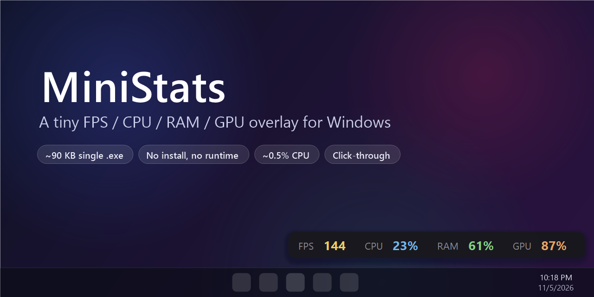
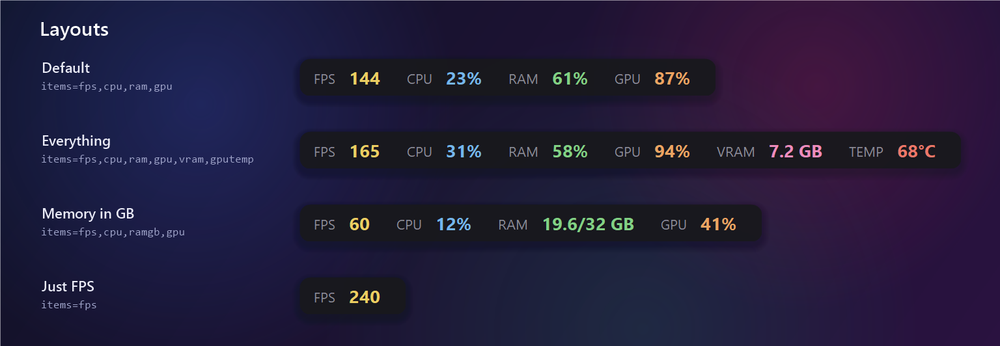
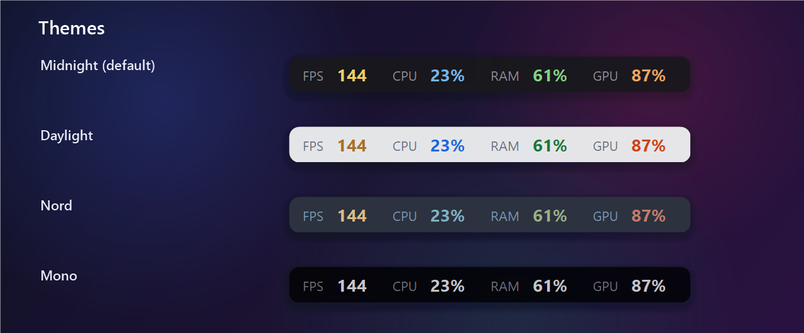

<div align="center">


# MiniStats

**A tiny, always-on-top FPS / CPU / RAM / GPU overlay for Windows.**
One ~90 KB executable. No installer, no runtime to download, no background services.

[](https://github.com/byocao/mini-stats/actions/workflows/build.yml)
[](https://github.com/byocao/mini-stats/releases/latest)

[](LICENSE)



</div>

---

## Why

Most hardware overlays are either tied to a GPU vendor's app, need a hotkey before they show up, or drag in a
kernel driver and 100+ MB of RAM just to print four numbers. MiniStats does one thing: it keeps a small,
click-through bar in the corner of your screen with the numbers you actually look at while gaming — and gets out
of the way.

## Features

- **Real FPS** of whatever window is in the foreground — games, emulators, browsers, video players.
  Measured from the same Windows present events that [PresentMon](https://github.com/GameTechDev/PresentMon) uses,
  so it works with DirectX 9/10/11/12 and falls back to kernel-level present events for other graphics APIs.
- **CPU** usage from the same counter as Task Manager (`% Processor Utility`).
- **RAM** usage as a percentage or as `used / total GB`.
- **GPU** load, **VRAM** and **GPU temperature** via NVIDIA NVML (ships with the driver — nothing to install).
- **Always on top & click-through**: it never steals focus or blocks a click. Stays visible over borderless/windowed games.
- **Configurable**: pick and reorder metrics, fonts, colours, opacity, rounded corners, position.
  Edits to `MiniStats.ini` apply **live**, no restart needed.
- **Per-monitor DPI aware**: crisp at 100–200 % scaling, on any monitor.
- **Featherweight**: around 0.5 % CPU on a typical gaming PC, a single ~90 KB `.exe`, built on the .NET Framework
  that already ships with Windows.

<p align="center"></p>
<p align="center"></p>

## Quick start

1. Download `MiniStats-win-x64.zip` from the [latest release](https://github.com/byocao/mini-stats/releases/latest)
   and extract it anywhere (e.g. `C:\Tools\MiniStats`).
2. Right-click `MiniStats.exe` → **Run as administrator**.
   *(Administrator rights are only needed for the FPS counter — see [FAQ](#faq). Everything else works without.)*
3. The bar appears in the bottom-right corner of your primary screen. Done.

To have it start automatically, right-click the tray icon → **Start with Windows**. This registers a logon task
that launches MiniStats elevated, so you will not get a UAC prompt on every boot.

### Tray menu

| Item | What it does |
| --- | --- |
| **Unlock to move** / **Lock position** | Makes the bar draggable (yellow outline). Locking saves the position. Double-clicking the tray icon toggles this too. |
| **Reset position** | Docks the bar back to the bottom-right corner of the primary screen. |
| **Edit config...** | Opens `MiniStats.ini` in Notepad. Changes apply as soon as you save. |
| **Start with Windows** | Creates / removes the `MiniStats` logon task (requires running as administrator). |
| **Exit** | Closes MiniStats and stops its trace session. |

## Configuration

`MiniStats.ini` is created next to the executable on first run.

```ini
# metrics, shown in this order: fps, cpu, ram, ramgb, gpu, vram, gputemp
items=fps,cpu,ram,gpu
interval_ms=1000

# appearance
font=Segoe UI
font_size=10
opacity=0.88
corner_radius=8
background=#18181C
color_label=#9696A2
color_fps=#FFDE66
color_cpu=#7CC4FF
color_ram=#8BE28B
color_gpu=#FFB066
color_vram=#FF96C8
color_temp=#FF806E

# position: leave x/y empty to dock to the bottom-right corner of the primary screen
margin=10
x=
y=
```

| Key | Default | Notes |
| --- | --- | --- |
| `items` | `fps,cpu,ram,gpu` | Any of `fps`, `cpu`, `ram`, `ramgb`, `gpu`, `vram`, `gputemp`, comma-separated. |
| `interval_ms` | `1000` | Refresh interval (minimum 250). FPS is averaged over this window. |
| `font`, `font_size` | `Segoe UI`, `10` | Any installed font; size in points. |
| `opacity` | `0.88` | `0.2` – `1.0`. |
| `corner_radius` | `8` | `0` for square corners. |
| `background`, `color_*` | see above | Hex colours. `color_label` is used for the `FPS` / `CPU` / … captions. |
| `margin` | `10` | Distance from the screen edge when docked. |
| `x`, `y` | *(empty)* | Absolute position in pixels; set automatically when you lock the bar after moving it. |

<details>
<summary><b>Theme presets</b> (copy into your ini)</summary>

```ini
# Daylight
background=#F6F7F9
color_label=#6E7781
color_fps=#B7791F
color_cpu=#1F6FEB
color_ram=#1A7F37
color_gpu=#D9480F
```

```ini
# Nord
background=#2E3440
color_label=#81A1C1
color_fps=#EBCB8B
color_cpu=#88C0D0
color_ram=#A3BE8C
color_gpu=#D08770
```

```ini
# Mono
background=#000000
opacity=0.75
color_label=#8A8A8A
color_fps=#FFFFFF
color_cpu=#FFFFFF
color_ram=#FFFFFF
color_gpu=#FFFFFF
```

</details>

## How it works

| Metric | Source | Cost |
| --- | --- | --- |
| FPS | Real-time ETW session subscribed to `Microsoft-Windows-DXGI` (Present), `Microsoft-Windows-D3D9` (Present) and `Microsoft-Windows-DxgKrnl` (Present). Events are filtered **in the kernel** by event ID, so only present calls reach the process. Presents are counted per process; the overlay shows the rate of the process that owns the foreground window. | A few hundred tiny callbacks per second |
| CPU | `Processor Information\% Processor Utility\_Total` performance counter | one counter read |
| RAM | `GlobalMemoryStatusEx` | one syscall |
| GPU / VRAM / temp | `nvml.dll` (`nvmlDeviceGetUtilizationRates`, `GetMemoryInfo`, `GetTemperature`) | three driver calls |

The window is a layered `WS_EX_TRANSPARENT | WS_EX_NOACTIVATE | WS_EX_TOOLWINDOW` popup, so clicks pass straight
through it and it never appears in Alt+Tab or the taskbar.

## Build from source

Requirements: Windows 10/11 x64. That's it — the C# compiler that comes with the .NET Framework 4.x is enough.

```bat
git clone https://github.com/byocao/mini-stats.git
cd mini-stats
build.cmd
```

The result is `bin\MiniStats.exe`.

```text
mini-stats/
├─ src/MiniStats.cs        # the whole app (overlay, ETW FPS tracker, NVML, config, renderer)
├─ src/AssemblyInfo.cs     # version metadata
├─ assets/icon.ico         # app icon (generated by tools/make-icon.ps1)
├─ tools/make-images.ps1   # regenerates docs/images with the app's own renderer
├─ build.cmd               # one-line csc build, no SDK needed
└─ .github/workflows/      # CI build + release on tags
```

### Developer switches

| Command | Purpose |
| --- | --- |
| `MiniStats.exe --probe 5` | Records present events for 5 s and writes `probe.txt` with present rates per process. Useful to check which process a game or emulator presents from. Run elevated. |
| `MiniStats.exe --render out.png --config my.ini --scale 2` | Renders the bar offscreen to a PNG with sample values (`--sample fps=144,cpu=23,...`). Used for the README images. |

## FAQ

**Why does FPS need administrator rights?**
Windows only lets administrators (or members of the *Performance Log Users* group) start a real-time ETW trace
session, which is how present events are observed. Without it MiniStats still runs and shows `FPS n/a`.

**FPS shows `--`.**
The foreground window isn't presenting frames (e.g. a static desktop or a minimised game), or the frames come from
a different process than the one owning the window. Run `MiniStats.exe --probe 5` as administrator while the game
is in front and open an issue with `probe.txt`.

**The bar disappears in some games.**
Exclusive fullscreen games own the whole display and nothing can be drawn on top of them. Switch the game to
*borderless* / *windowed fullscreen* — this is also what most modern games default to.

**GPU shows `--`.**
GPU metrics currently use NVIDIA NVML. AMD / Intel support via the Windows *GPU Engine* counters is on the roadmap.

**Is it safe? Does it inject into games?**
No injection, no hooks, no kernel drivers. MiniStats never touches the game process; it only reads public Windows
telemetry (ETW, performance counters) and the NVIDIA driver API — the same sources Task Manager and PresentMon use.

## Roadmap

- [ ] AMD / Intel GPU load via `GPU Engine` performance counters
- [ ] Frame-time graph (1 % low)
- [ ] Per-monitor docking presets (e.g. "bottom-right of monitor 2")
- [ ] Optional network up/down speed

## License

[MIT](LICENSE) © byocao
